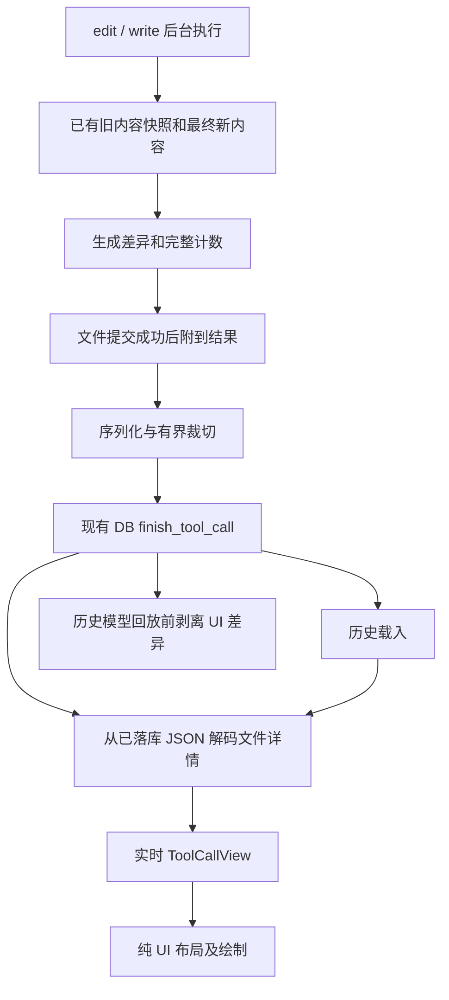

# lx 文件工具 Diff：设计

> 状态：待用户审核；尚未开始实现。
> 日期：2026-10-21。
> 目标页面：lx / Native Agent 对话时间线。
> 参考仓库：`/Users/yonah/projects/agent/codex-main`。
> 本阶段只新增本目录的设计与任务文档，不修改生产代码、依赖或 Git 状态。

## 1. 已确认的产品边界

以下四项由用户逐项选择“使用推荐”确认：

| 决策 | 已确认行为 |
| --- | --- |
| 展示时机 | 展示 `edit`、`write` 执行后的实际变更，不增加执行前审批 |
| 默认展示 | 每个文件最多预览 3 个物理行；点卡片内容展开完整 diff、行号及相邻上下文 |
| 操作范围 | 新建、覆盖、修改、删除、移动；移动显示旧路径 → 新路径及内容差异 |
| 超大结果 | 允许截断 diff 正文；保留文件路径和完整增删计数，明确显示 `Diff truncated`，实时与历史一致 |

下面的技术细节是本次待审核方案，不把它们冒充为用户已经逐项确认的要求。

特别需要随本设计审核的技术取舍：删除二进制/不可解码文件时不存在可用的文本行统计，拟显示未知；极端情况下连全部文件路径都超过 1 MiB，拟保留完整调用总计并明确省略部分文件摘要；超大输入拟采用明确标注的线性简化脚本，其完整增删数可能大于最小编辑脚本。用户尚未单独确认这三项取舍，文档审核不通过就不能按此实施。

### 1.1 成功标准

用户不需要打开文件或读取工具参数，就能从工具步骤中看出“哪个文件，哪里删了什么，哪里加了什么”。
普通大小结果可完整展开；关闭并通过 `/resume` 重开会话，得到相同的文件路径、变更正文、行号、计数和截断状态。

### 1.2 本期不包含

- `read`、`search` 正文展开；shell 命令间接改文件的检测。
- 输入参数流中的拟应用 diff、审批页、撤销、回滚、Git 工作区 diff 或暂存操作。
- 独立 diff 弹窗、并排双栏、逐字高亮、代码语法高亮、外部编辑器入口。
- 复制 Codex 的主题、终端色深探测、超链接或整套 patch 工具实现。
- 回填旧历史的文件正文；当前文件已经变化，不能拿它伪造过去的差异。

## 2. 规范和检索依据

实现必须遵守四份规范：

- `docs/standards/project-directory-structure.md`
- `docs/standards/code-writing-standards.md`
- `docs/standards/tui-design-requirements.md`
- `docs/standards/html-assets.md`

本次没有浏览器资源变更。`app/` 保持纯状态，`ui/` 保持纯渲染，文件读取和差异计算在现有后台工具执行路径完成。

已使用 codegraph 和 codebase memory 的符号检索、调用链、源码及覆盖率检查。lx 相关核心路径的 memory 覆盖结果为 `no_recorded_issue / metadata_match`；这只是尽力覆盖信号，不等于完整性证明。参考仓库的 memory 元数据已过时，参考行为以 codegraph 当前源码及定点源码读取为准。

已通过 Context7 查阅 `/mitsuhiko/similar` 的行差异和配置 API；参考仓库 `codex-rs/Cargo.toml:476` 使用 `similar = "2.7.0"`。Context7 可能返回主分支文档，实现时以选定的 2.7 版本编译接口为准，不使用主分支新增的空白忽略 API。

### 2.1 当前 lx 的关键事实

以下行号是设计时定位，不是未来实现的固定行号。

| 位置 | 当前行为 | 本次影响 |
| --- | --- | --- |
| `src/chat/tools/types.rs:148` | `FileChangeKind` 已有 Added/Updated/Deleted/Moved | 复用动作，不再建第二套动作枚举 |
| `src/chat/tools/types.rs:164` | `FileChange` 只有路径、动作、增删计数 | 增加独立的结构化差异数据 |
| `src/chat/tools/types.rs:208` | Write 只有 path/created/added/removed | 为新建和完整覆盖补上差异 |
| `src/chat/tools/write.rs:54` | 已读旧内容、计算新行、保留 BOM/换行 | 利用已有快照，不在 UI 重新读文件 |
| `src/chat/tools/text.rs:135` | `line_diff_counts` 只剥公共前后缀 | 多处零散修改会高估；与正文统一差异来源 |
| `src/chat/tools/edit.rs:162` | 多文件依次提交，失败携带已成功 changes | 已成功文件仍应显示差异 |
| `src/chat/tools/edit.rs:235` | before == after 时直接跳过 | 纯移动也被跳过；需要在本范围内修正 |
| `src/chat/tools/edit.rs:253` | 先更新源文件，再准备目标目录并 rename | 目录创建/rename 失败时源文件可能已变，不能漏报 |
| `src/chat/tools/output.rs:419` | `to_result_json` 生成规范化落库 JSON | 扩展 JSON，按最终序列化字节限制 diff |
| `src/chat/tools/output.rs:526` | shrink 只裁 content/output/matches | 不会裁 changes 中的 diff；超限兜底还会丢失摘要 |
| `src/db/chat/tools.rs:18` | 单条结果硬上限 1 MiB | 不能因为 UI 差异过大导致结果无法落库 |
| `src/event/chat/tool_calls.rs:173` | DB 成功后写实时状态与回执 | 保持 DB 门槛，不提前展示成功 |
| `src/app/state/lx/chat/tool_view.rs:242` | 类型化详情只有进程、交互、计划 | 增加文件详情分支，UI 不解析 JSON |
| `src/app/update/chat/view.rs:67` | 历史详情从 result_json 还原 | 与实时共用文件详情解码 |
| `src/ui/main_content/lx/history/tool.rs:55` | 普通文件卡片固定两行 | 文件 diff 使用可变行数，布局和绘制共用口径 |
| `src/ui/main_content/lx/history.rs:338` | 只为进程 `[open]` 注册 ToolHit | 新增明确的文件展开命中，不能误开任务页 |
| `src/app/update/chat/process.rs:376` | 已有 toggle_tool_detail 和视口固定 | 复用状态与行为，不另建一套展开状态 |
| `src/chat/context/mod.rs:373` | 成功历史直接回放 result_json，再裁到 64 KiB | 回放前剥离新增 UI diff，避免额外占用模型上下文 |

### 2.2 Codex 的可复用行为

| 参考位置 | 行为 | lx 采用方式 |
| --- | --- | --- |
| `codex-rs/apply-patch/src/file_update.rs:176` | 基于真实旧/新内容，默认 1 行上下文 | 采用真实前后快照及 1 行上下文 |
| `codex-rs/tui/src/diff_model.rs:10` | Add/Delete 内容与 Update 差异分开建模 | 借鉴内容与动作分离，复用 lx 的动作枚举 |
| `codex-rs/tui/src/diff_render.rs:442` | 文件路径与 +N/-N 摘要 | 采用，保持 lx 原有标题和树形详情风格 |
| `codex-rs/tui/src/diff_render.rs:700` | 新增取新行号，删除取旧行号 | 采用，展示真实文件行号 |
| `codex-rs/tui/src/diff_render.rs:660` | 分离 hunk 之间显示 `⋮` | 采用，原始 `@@` 不直接铺到 UI |
| `codex-rs/tui/src/diff_render.rs:884` | 长行按显示列换行，续行不重复行号 | 采用，中文宽字符参与列宽计算 |
| `codex-rs/tui/src/activity_preview.rs:7` | 每文件 3 个预览物理行 | 采用；上下文不消耗变更预览名额 |

不直接复制 Codex 的 unified diff → diffy 再解析链。lx 由工具层直接生成结构化 hunks，避免额外文本协议和第二个差异解析依赖。

### 2.3 直接影响设计的关键现有代码

lx `edit.rs:235` 当前的提前返回没有区分纯移动：

```rust
if before == after {
    return Ok(None);
}
```

本期需要让 move_to 存在的操作继续进入移动路径；不是只给原有 Updated 结果加上颜色。

lx `write.rs:64` 当前的计数与写入已经持有必要的前后数据：

```rust
let after_lines = split_lines(content);
let (added, removed) = line_diff_counts(&before_lines, &after_lines);
```

应从这里替换为“计数 + 差异”同源结果，而不是写完文件后又读一次旧文件；那时旧内容已经不存在。

参考仓库 `apply-patch/src/file_update.rs:197` 的核心做法：

```rust
let text_diff = TextDiff::from_lines(&original_contents, &new_contents);
let unified_diff = text_diff.unified_diff().context_radius(context).to_string();
```

lx 采用相同的真实 before/after 来源，但把结果转换为下文的类型化行，不再生成统一 diff 字符串后重新解析。

## 3. 总体数据流



不变量：

1. diff 的 old 来自本次工具实际读取的旧内容，new 来自本次准备写入的最终内容，不直接把模型 patch 输入染色充当结果。
2. 只有确认提交的文件变更进入 changes；失败前已经写入的源文件也是已提交变更。
3. `ToolSummary` 仍只装摘要；差异正文进入独立的类型化详情。
4. 实时与历史都解码同一份经过裁切的落库 JSON，不保留“实时专享”的完整副本。
5. UI 不读取文件、不访问数据库、不计算行差异、不每帧解析结果 JSON。
6. 展开只改变显示范围，不恢复已被存储预算裁掉的数据，也不重新读磁盘补齐。

## 4. 差异数据契约

### 4.1 推荐类型

在 `chat/tools/` 内按职责增加 `diff.rs`。下面是约束接口的示意代码，最终可调整命名，但不能改变语义：

```rust
pub enum FileDiff {
    Complete { hunks: Vec<DiffHunk> },
    Truncated { hunks: Vec<DiffHunk> },
    Unavailable { reason: DiffUnavailableReason },
}

pub struct DiffHunk {
    pub lines: Vec<DiffLine>,
}

pub struct DiffLine {
    pub kind: DiffLineKind, // Context / Added / Removed
    pub old_line: Option<usize>,
    pub new_line: Option<usize>,
    pub text: String,
    pub no_final_newline: bool,
}
```

- 所有行号为 1-based；Added 没有 old_line，Removed 没有 new_line，Context 两者都有。
- `text` 不含行尾换行；保留普通空白，不用 trim() 改掉缩进。
- EOF 无换行由 `no_final_newline` 表达，不把提示字符串混进文件正文。
- `Complete` 空 hunks 表示没有内容差异，可用于空文件创建、纯移动和内容相同的 write。
- `Truncated` 可以空 hunks，表示预算没有留下正文；不能误判为“没有变化”。
- `Unavailable` 使用稳定原因码，例如 `binary`、`not_utf8`、`read_failed`；英文 UI 文案在 `ui/text.rs` 映射。
- 执行结果 `FileChange` 增加 diff；Write 增加 diff，并继续保留原有 path/created/added/removed 字段。
- app 文件详情包含每个文件的路径、动作、计数和 diff；可复用 chat 暴露的纯数据类型，不把执行器、IO 对象或 UI 样式带入 app。
- 文件列表保持工具提交顺序，便于对应部分失败；不为模仿 Codex 的路径排序改变 lx 的操作顺序。
- 超大输入采用线性简化编辑脚本时，携带 `simplified: true` 元数据；计数是该完整脚本的精确统计，不是从预览推算的估值。

### 4.2 JSON 扩展

保留当前顶层 tool/changes/path/created/added/removed/error 语义。给单个文件结果增加可选的 `diff` 字段，并增加局部格式版本以识别新增结构。

```json
{
  "tool": "edit",
  "partial": false,
  "changes": [{
    "path": "/workspace/main.rs",
    "kind": "updated",
    "added": 1,
    "removed": 1,
    "diff": {
      "version": 1,
      "status": "complete",
      "hunks": [{"lines": [
        {"kind":"removed","old_line":8,"new_line":null,"text":"hello","no_final_newline":false},
        {"kind":"added","old_line":null,"new_line":8,"text":"world","no_final_newline":false}
      ]}]
    }
  }]
}
```

实际结果中有相邻行时还会含上下文；示例仅展示字段关系。Write 的 diff 与其 path/created/added/removed 并列。Error 的已提交 changes 采用同一文件格式。

兼容规则：

- 旧结果没有 diff：保留原两行摘要，不尝试恢复历史差异。
- 未知 diff version、非法行类型或错误行号：该文件显示 `Diff unavailable`，其他合法文件继续显示；不能让整条会话加载失败。
- JSON 解析和结构验证在状态投影时完成，不放进绘制热路径。
- 不改 SQLite 表结构，不新增迁移；使用已有 result_json 列。

### 4.3 计数状态与调用总计

为避免“未知的 0”和“裁切后前缀的和”冒充完整计数，明确增加下列契约，而不是只在 UI 猜测：

| 字段 | 位置 | 含义 |
| --- | --- | --- |
| `counts_known` | 每个 change / write | bool，旧 JSON 缺省按 true；新结果无法解码旧内容时为 false |
| `simplified` | 每个 change / write | bool，缺省 false；计数来自线性简化脚本时为 true |
| `file_totals.files` | 文件结果顶层，包括 error | 本次实际提交的完整文件数，截断文件列表前计算 |
| `file_totals.added/removed` | 同上 | 完整调用计数；任一文件无法统计时为 null，不能填前缀和或 0 |
| `file_totals.simplified` | 同上 | 是否至少有一个文件使用简化脚本 |
| `omitted_files` | 同上 | 未能保存摘要的文件数，缺省 0 |

保留原来的数字型 added/removed 以兼容现有 JSON 形状；仅在 counts_known=false 时，原数值是兼容占位，所有新消费路径必须先检查标志并显示未知，不把占位 0 当事实。普通可解码结果的数字仍是完整编辑脚本的精确计数。

摘要投影规则：

1. 工具侧 `to_summary` 取完整执行结果总计；未知时 added/removed 为 None，并携带明确的未知状态。
2. app 的 ToolSummary 增加计数已知性、简化标志及遗漏文件数等小型元数据，仍不存正文；`is_empty` 必须覆盖新增字段。
3. 历史 `absorb_result_json` 优先使用 file_totals，不对裁切后的 changes 前缀重新求和；旧 JSON 没有 file_totals 才用原有求和规则。
4. 实时 `absorb_summary` 与历史同口径：结果明确未知时，必须清掉参数或既有摘要中的数字，不能因 None 而保留旧值。
5. 当前模型 `format_for_model` 显示同一完整总计/简化/未知状态；失败 `failure_content` 与无错误文本的 JSON 回放兜底也必须保留 file_totals、counts_known、simplified、omitted_files 的语义。
6. UI 每文件统计取其 counts_known；调用级统计取 file_totals。元数据被省略时显示总文件数/完整总计与遗漏数，不把可见文件数说成全部。

不承诺“最小编辑脚本”作为计数唯一口径：正常算法和资源降级都必须计满各自完整脚本的所有增删，预览/存储截断不改变计数。线性简化脚本须明确标识，不能和正常脚本的差异规模悄悄混用。

## 5. 差异生成及计数

### 5.1 依赖选择

新增 `similar` 2.7 系列直接依赖，使用行差异及分组能力，关闭不需要的额外功能。当前标准库没有最小行编辑脚本算法，现有 `line_diff_counts` 不能给出分离 hunks；自己写 Myers/LCS 会引入更多代码和维护成本。

只新增一个差异库，不引入 diffy、语法高亮器或 Git 依赖。锁定版本后核对 `Cargo.lock` 以及实际启用的特性。

核心步骤示意：

```rust
let diff = similar::TextDiff::configure()
    .timeout(std::time::Duration::from_millis(100))
    .diff_lines(&before_text, &after_text);

// 先遍历完整操作计算计数，再按上下文半径 1 分组。
// 由每个 change 的 old_index/new_index 建立 1-based 真实行号。
// hunks 的正文保存受预算限制，计数不受预览/存储裁切影响。
```

`similar` 的 timeout 是尽力限制，超时可能产生较粗但仍能表达转换的编辑脚本，不是严格 CPU 截止，也不能将它解释成 IO 失败。实现不用“必须得到全局最短 diff”作为正确性条件。

### 5.2 文本与 EOF

- 旧内容使用 `SourceText` 解码；新内容基于现有编码逻辑最终要写入的文本。
- diff 比较时统一逻辑换行，不把保留下来的 CRLF/BOM 当作所有行都改动。
- 必须保留末行是否有换行的信息；`hello` → `hello\n` 是实际变化，不能显示为无变化。
- write 只改 EOF 换行时，展示末行替换和 EOF 提示；计数按同一编辑脚本解释。
- edit 保持既有 BOM/换行保存行为；不趁机重做文本编码器。
- `+`、`-`、`@@`、三反引号等正文只作为文本绘制，不经过 Markdown 或 ANSI 解释器。

### 5.3 资源限制（待本设计审核）

| 限制 | 建议值 | 超限行为 |
| --- | --- | --- |
| 复杂 diff 输入总字节（old + new） | 8 MiB | 使用线性简化脚本，不跑复杂差异算法 |
| 复杂 diff 输入总行数（old + new） | 100,000 | 同上，避免大量短行造成操作对象膨胀 |
| 单文件算法超时配置 | 100 ms | 库给出可应用的较粗编辑脚本；不是严格时间承诺 |
| 单次调用保留的差异正文 | 最终 JSON 中最多 512 KiB，且受剩余空间限制 | 删除尾部差异记录，状态设为 truncated |
| 单次调用保留的差异行对象 | 最多 10,000 | 超出行不保存，计数仍来自完整操作 |
| 最终工具结果 JSON | 不超过现有 1 MiB | 优先移除正文，最后才裁文件列表并显式记录遗漏 |

新建/删除不需要复杂差异算法，可线性统计完整行数并按预算保留正文。对于超大 update/write，剥离公共前后缀，将剩余旧区间全部作为删除、新区间全部作为新增，形成能完整还原 old → new 的线性简化脚本。计数精确统计这个完整脚本，正文再按预算裁切；不使用预览行数、采样或估计计数。标记 `simplified: true` 并显示 `Diff simplified`，明确它可能比最小编辑脚本包含更多增删行，但不是少算了未展示的内容。

该降级必须复用现有前后缀能力形成“计数 + 差异正文”同源结果，不能只拿粗略计数配另一套更小的正文。不因为 UI 差异超限拒绝原来合法的文件操作。

这些阈值只约束新增差异计算和展示，不改现有工具输入上限或全文件读写能力。不为本功能额外读取同一文件一次。

## 6. 提交与失败语义

| 场景 | 结果和 UI |
| --- | --- |
| write 新建 | 文件确实创建后发布 Added；全为绿色新增，空文件仍有创建摘要 |
| write 覆盖 | 原文件 → 最终内容的差异；相同内容显示 `No content changes` |
| edit 修改 | 应用全部 block 后，依据最终 before/after 生成差异，不直接统计输入 patch 充当展示 |
| edit 删除文本 | 删除前捕获旧文本，删除成功后发布全红差异 |
| edit 删除二进制/不可解码文件 | 保持原先可删除行为，显示 `Diff unavailable`；无法统计的行数显示未知，不把旧实现的 0 当作准确计数 |
| 修改并移动成功 | 旧路径 → 新路径，正文为内容 diff，结果动作为 Moved |
| 纯移动 | 不因 before == after 被跳过；只移动，不伪造增删内容，显示 `No content changes` |
| 修改写入失败 | 不发布该文件的成功 diff；显示真实错误 |
| 修改已写入、随后准备目录或 rename 失败 | Failed 中补入该源路径的 Updated 及 diff；明确文件未移走 |
| 多文件中途失败 | 整体 Failed，保留此前所有已提交文件的差异；不显示尚未执行文件的拟变更 |
| 全部未产生变化 | 保持现有 NoChanges 失败语义；不伪造成功文件 |
| 用户取消或 DB 保存失败 | 沿用现有握手语义；不能为补 diff 再次执行文件写入 |

`Edit.partial` 当前表示“存在没有产生实际变化的 hunk”；IO 中途失败由 `Failed { changes }` 表达，两个概念不得混用。

为最小修改，移动失败可在 edit 模块内部使用携带已提交变更的失败类型：

```rust
struct CommitFailure {
    cause: ToolFailure,
    committed: Option<FileChange>,
}
```

普通错误只有 cause；源文件已写入之后的错误还携带 Updated。外层 commit 先累加 committed，再产生 Failed。无需给所有工具的 ToolFailure 增加文件专属字段。

不新增跨文件事务、不谎报回滚。现有路径锁只覆盖短提交过程，外部编辑器或其他窗格可能在读取快照与提交之间写文件；本期 diff 反映本次观察到的旧内容与本次写出的内容，不承诺对并发外部写入提供事务快照。若需要消除这一窗口，应单独设计并发控制。

## 7. 存储裁切与恢复

### 7.1 按最终 JSON 字节预算

不能只数正文字符串的 UTF-8 字节。引号、反斜杠和控制字符序列化后会膨胀，行对象和路径也占空间。

推荐顺序：

1. 保存操作类型、错误、每文件路径/动作、完整可统计计数及必要状态。
2. 按提交顺序分配剩余 diff 预算；构造行对象时就限制保留内容，避免先复制完整巨型差异再裁。
3. 按完整行记录、hunk 从尾部移除；任何未保存正文的文件必须为 Truncated，保留行不改原始行号。
4. 检查最终 JSON 长度；超限继续移除正文，不能直接落入当前“只剩 note”的兜底。
5. 极端情况下，仅文件路径/元数据已超过硬上限：保留可容纳的文件摘要前缀，增加 `omitted_files`、总文件数、完整总计数及简化/未知标志。明确提示 `N files omitted`，不能伪装成全部展示。

超长单行不能被任意剪断后仍标 Complete。预算放不下完整行时，截断该行及后续正文并显示截断提示；不拆坏 UTF-8，也不保存半个 JSON。

### 7.2 实时与历史同源

现有实时详情 `detail_of(&outcome)` 取原始结果，历史详情 `from_result_json` 取存储结果。本次仅针对文件详情统一为：

```rust
// 伪代码：必须在 finish_tool_call 成功之后。
let detail = file_detail_from_result_json(result.result_json.as_deref());
settle_tool_detail(state, pane, &key, call_id, detail);
```

历史 `tool_view_of` 调同一解码函数。进程卡片的运行态校正保持原有路径，不顺手更换所有工具的数据源。

DB 失败继续返回 HostError，不自动重试文件工具。结果序列化失败也不能悄悄表现成“没有差异”；沿现有错误路径报告，至少保留摘要结果。

### 7.3 历史与旧版本兼容

- 新版读取旧记录：没有 diff 就使用原摘要，文件不增加无效展开入口。
- 新记录重载：使用保存的差异，不读当前磁盘内容；磁盘文件删除或变化也不影响记录。
- 展开状态使用当前 LxChat 的 `(message_id, call_id)` 键；加载会话后默认折叠，不要求跨重启保存用户的展开选择。
- 删除/切换会话保持既有状态清理；不新增持久化偏好表。

## 8. 模型上下文边界

`format_for_model` 当前给文件操作摘要，本期继续这一行为。新增 UI 差异不应让模型下一轮多接收整份文件内容。

必须在历史 `replay_pair` 结果准备阶段，针对文件结果和含已提交文件的 error 结果剥离新 `diff` 字段，再交给现有 64 KiB 回放限制。

- 只移除本功能定义的展示字段，不删 path/kind/to/added/removed/partial/code/message 等原有信息。
- error 无错误文本而走 JSON 回放的兜底也必须剥离。
- 非文件工具及未知旧结果沿用原行为，不做广泛 JSON 重写。
- 不修改 call ID、步骤顺序、失败状态、call/result 成对关系或上下文裁剪规则。
- 新的简化/未知计数标志和 omitted_files 等语义元数据应保留，避免模型误解摘要的统计口径。

## 9. TUI 展示与交互

### 9.1 卡片结构

保留 lx 的方块状态标记、动词、缩进和工具间空行，不新增边框或独立窗口。

```text
■ Edit
  ├─ src/main.rs (+1 -1)
       8 - hello
       8 + world
  └─ src/lib.rs → src/core.rs (+0 -0)
       No content changes
```

示例是内容关系，不要求逐字复刻空格。实际文案由 text 模块生成，所有宽度由真实终端列数计算。

- 单文件也展示文件路径与计数；多文件逐个展示，移到新路径时两端都可见，长路径按现有中间省略规则处理。
- 新增绿色、删除红色、上下文默认正文色；行号和 hunk 分隔符弱化。
- 增删行铺整行背景色（`agent_added_bg` / `agent_removed_bg`，对齐 Codex），上下文行不铺；
  语法高亮复用共享词法，不引入 syntect/tree-sitter 之类构建级依赖；`+`/`-` 仍保留，
  无彩色/无色背景的终端照样可区分。
- 失败标题保留红色，但已提交正文仍以红删绿增展示，不能把成功变更全部染成错误内容。
- EOF 标记使用 `No newline at end of file`，是元信息行，不计入新增/删除数。

### 9.2 预览与展开

- 每个文件先筛选 Added/Removed，再按可用列宽换行，最多保留 3 个物理行；上下文不占预览额度。
- 如仍有未显示的已保存内容，在该调用块末尾**单独一行**写**剩余行数**（`… 421 more lines`），
  不占预览额度、展开后消失；没有剩余内容时不画这一行。
- 展开后显示所有已保存 hunks 和每个 hunk 前后各 1 行上下文；相邻上下文合并，分离处显示 `⋮`。
- **没有动作按钮、没有 `open` 行**：整块卡片就是展开/收起入口——点折叠内容展开、
  展开后点内容（未拖拽）收起。标题行不可点。
- 连续的**同种**文件调用（相邻、同名、都带差异正文）**共用一行合并标题** `■ 动词 N files (+A -R)`，
  其下每个调用各自一块：自己的文件头（`└─`）、自己的预览、自己的展开状态与自己的命中区，
  **块与块之间空一行**（相邻调用是两次独立动作，紧贴会读成一棵树）。
  `edit` 与 `write` 不同名，不共享标题；被正文/思考步骤打断即分组。
- 保留 `^o` 和现有工具选择键位入口；文件详情进入现有可选择集合。普通上下箭头仍用于输入。
- 命中统一走 `CardHit { kind, card, fold }`：`card` 是整块点击面（`card_target_at`），
  `fold` 是 hover 提亮区（`fold_target_at`）。两者判据不同，不能共用一个矩形。
- 无 diff 的旧卡片保留原两行展示；状态提示型详情不能制造无意义的无限展开。
- 标题以外正文继续支持聊天选区，不把整张卡片变成吞掉选区的按钮。

### 9.3 几何一致性

文件 diff 子模块提供同一个纯布局入口，由 rows 和 draw 共用：

```rust
// 示意：返回带语义/样式的物理行，供计数、绘制和命中使用。
fn lines(view: &FileDiffView, width: u16, expanded: bool) -> Vec<DiffRenderLine>;
```

- 行数统计、真实绘制推进和滚动范围必须相等，不用旧的“两行卡片”估算。
- 宽度扣除历史滚动条列、树形缩进、行号和符号 gutter 后才换行。
- 中文和宽字符按 unicode-width 算列；长行续行保留空 gutter，不重复行号或 `+`/`-`。
- Tab 使用固定 4 列制表位展开；其他控制字符安全文本化，不执行 ESC/ANSI，不把文本插入终端指令。
- 宽度不足时依次让掉行号和非必要缩进，保留变更符号；0 宽返回 0 行，不能在 1 列宽中死循环。
- 极窄放不下双宽字符时按现有 Grid 规则安全降级，不越界、不 panic。
- 展开调用现有 pin_lx_viewport；上滚位置不因卡片增长跳到底，跟随底部语义由已有锚点逻辑保持。
- 命中矩形复用布局结果，并经过 sticky body 和 scroll 的同一坐标转换。

## 10. 文件归属与拆分计划

设计时统计：`history/tool.rs` 997 行，`history.rs` 966 行，`lx.rs` 1050 行。后者已超过项目上限，前两者也不能继续堆代码。

| 文件/模块 | 计划职责 |
| --- | --- |
| `src/chat/tools/diff.rs`（新增） | 纯差异算法、行号、计数、上下文分组及生成预算 |
| `src/chat/tools/types.rs` | 挂接差异类型，保持 ToolSummary 无正文 |
| `src/chat/tools/edit.rs`、`write.rs` | 复用快照，提交后携带差异，处理移动部分失败 |
| `src/chat/tools/output/`（按实际行数拆分） | 把文件结果序列化/预算独立，output.rs 保留呈现入口 |
| `src/app/state/lx/chat/file_diff.rs`（新增） | 文件详情模型、兼容解码和字段验证 |
| `src/app/state/lx/chat/tool_view.rs` | 新增 FileDiff 分支并委托解码，不在此堆完整实现 |
| `src/event/chat/tool_calls.rs` | 文件详情取已落库 JSON，保持 ack 门槛 |
| `src/app/update/chat/view.rs`、`process.rs` | 实时/历史投影和已有展开/选择接口接入 |
| `src/chat/context/` | 窄范围剥离 UI diff 字段，保留回放上限 |
| `src/ui/main_content/lx/history/tool/file_diff.rs`（新增） | 文件差异的行布局、预览、完整绘制 |
| `src/ui/main_content/lx/history/tool/file_summary.rs`（新增） | 从近 1000 行父文件迁出现有普通文件摘要组装职责 |
| `src/ui/main_content/lx/history/tool.rs` | 工具类型分派及共用 Segment/标题能力 |
| `src/ui/main_content/lx/history_hit.rs`（新增） | 从 lx.rs 迁出聊天历史命中函数，包含展开与任务打开的区分 |
| `src/ui/main_content/lx/history.rs` | 调用统一 diff 行数，收集整卡点击面与 hover 区（`CardHit { card, fold }`） |
| `src/event/mouse/press.rs` | 分派文件展开命中，不改进程任务页语义 |
| `src/ui/style.rs`、`src/ui/text.rs` | 差异语义样式及全部新增可见文案 |
| 四份规范中实际受影响的条款 | 更新文件工具展示、可变行数及新增模块说明 |

表中的新增源码文件只在实施时按需要创建，不提前建立空壳。拆出的子模块以约 500 行为目标，所有触及文件必须 ≤1000 行；不顺手做全仓重构。

## 11. 验证与验收矩阵

| 层次 | 必须覆盖的情形 | 关键断言 |
| --- | --- | --- |
| 纯差异 | 新建/删除/替换/两处远距变更/重复行/中文 | 正确行号和小 hunks，零散修改不吞掉中间未改行 |
| 文本边界 | 空文件/空行/末行无换行/EOF-only/CRLF/BOM | 不把格式保留误判成全文件变化，不漏 EOF-only |
| 执行结果 | write 覆盖、edit 多文件、纯移动、移动失败 | diff 只属于实际提交；失败仍保留已写源文件 |
| 资源与 JSON | 巨大行/大量短行/引号反斜杠/大量文件 | 最终 JSON ≤1 MiB，UTF-8 与 JSON 合法，摘要和截断标志保留 |
| 兼容 | 旧结果、未知版本、坏 diff、部分文件损坏 | 会话可载入，其他文件保留，显示明确降级 |
| 状态同源 | 首次结算、`/resume`、已裁切结果 | typed view 完全一致；重开不读取磁盘补差异 |
| 上下文 | 成功/失败/error兜底/旧记录/非文件工具 | 新 UI 正文不进模型历史，原字段与调用配对保留 |
| UI 行布局 | 展开/折叠、宽/窄/0宽/极矮、中文和长行 | layout rows == draw rows，续行 gutter、颜色和 + / - 正确 |
| 交互 | 整块点击展开/收起、hover 提亮、^o、工具选择、任务 `open`、上滚展开 | 文件展开不打开任务页；拖拽选中不折叠；视口锚点和正文选择正确 |

自动验证按阶段只跑受影响的测试和检查；最后按项目交付规范运行 fmt/clippy/test，已通过后不无理由重复全量。

本节写作时尚为文档阶段；实施后已补充 §14，自动验证结果见该节。真实终端外观与交互仍由用户 `cargo run` 确认，Agent 不宣称完成这部分人工验证。

## 12. 风险、降级与回退

1. **资源膨胀**：新建/删除也可能含大量内容。生成时限制保存行数和字节，序列化后再次检查；不先复制所有差异再截断。
2. **计数语义变化**：普通 write 的零散修改统计将更准确；超大输入精确统计明确标注的简化脚本，可能比最小脚本包含更多增删行，不使用估计值。
3. **删除旧内容不可读**：不为了 diff 改变删除权限行为；以不可用/未知提示降级。
4. **移动失败的部分提交**：必须回报已经写入的源文件；不提供自动回滚承诺。
5. **并发窗口**：现有短写锁不是读改写事务；不承诺并发修改时的全局快照一致性。
6. **旧历史不可补齐**：缺少旧内容就保留旧摘要，不读取今天的文件伪造昨天的 diff。
7. **展示源码入库**：新增差异会随原有会话存储保留，删除内容也会保存；不额外发网络，模型回放剥离 UI 正文。
8. **超多文件摘要也超限**：最终允许显式省略文件摘要并记录 omitted_files/总数，绝不默默退化为只有 note。
9. **回退**：移除新详情分派可退回原摘要；不需 DB 反向迁移。没有用户明确授权，不执行 Git reset/revert/checkout 或提交。

## 13. 审核门槛与完成定义

当前门槛：用户审核本 design 和同目录 task 后才能改生产代码。四次“使用推荐”只确认了 §1 的产品边界，不替代文档审核。

实施完成要求：四类文件动作有真实结果差异、每文件三行预览和完整展开、超限明确提示、实时/历史同源、失败不丢已提交差异、UI 正文不额外进入模型回放、受影响自动验证通过。终端观感和真实供应商调用分别列为人工待验收，不用文档勾选伪造通过。

## 14. 实施记录（与设计的偏差）

本节记录实际落地的类型、阈值与文件归属；与上文示意不一致处以本节为准。

### 14.1 实际类型（`src/chat/tools/diff.rs`）

```rust
pub enum DiffLineKind { Context, Added, Removed }
pub struct DiffLine { kind, old_line: Option<usize>, new_line: Option<usize>, text: String, no_final_newline: bool }
pub struct DiffHunk { lines: Vec<DiffLine> }
pub enum DiffUnavailableReason { Binary, NotUtf8, ReadFailed }   // as_str/from_stored 稳定码
pub enum FileDiff {
    Complete { hunks: Vec<DiffHunk>, simplified: bool },
    Truncated { hunks: Vec<DiffHunk>, simplified: bool },
    Unavailable { reason: DiffUnavailableReason },
}
pub struct DiffCounts { added, removed, truncated, simplified }
```

`simplified` 落在 `Complete`/`Truncated` 变体上；`FileDiff::simplified()` / `counts_known()` / `truncated()` /
`hunks()` 是唯一读取口径。app 层镜像为 `FileDiffView`（`Complete`/`Truncated`/`Unavailable { reason: &'static str }`），
渲染层与 app 层都不依赖工具执行器。

### 14.2 实际阈值

| 限制 | 实现值 | 位置 |
| --- | --- | --- |
| 复杂差异输入（old + new） | 8 MiB / 100,000 行 | `MAX_DIFF_INPUT_BYTES` / `MAX_DIFF_INPUT_LINES` |
| 单文件差异算法超时 | 100 ms（`similar` 的尽力限制） | `DIFF_TIMEOUT` |
| 单文件保存行对象 | 10,000 行 | `MAX_DIFF_LINES` |
| 单次调用差异正文 | 512 KiB / 10,000 行 | `output/file.rs` 的 `MAX_DIFF_JSON_BYTES` / `MAX_DIFF_JSON_LINES` |
| 最终结果 JSON | 现有 `MAX_TOOL_RESULT_BYTES`（1 MiB） | `tools/output.rs` 统一硬上限 |

裁切顺序：按提交顺序分配正文预算 → 从尾部移除完整行/hunk 并置 `truncated` → 正文裁光仍超限时保留文件摘要前缀并记
`omitted_files` 与完整 `file_totals` → 绝不退化成只剩 `note`。计数永远来自完整编辑脚本，裁正文不改总计。

### 14.3 实际文件归属

| 文件 | 职责 |
| --- | --- |
| `src/chat/tools/diff.rs` + `diff/tests.rs` | 纯差异算法、hunk/行号、上下文分组、简化脚本、生成预算 |
| `src/chat/tools/output/file.rs` + `output/tests.rs` | 文件结果 JSON、`file_totals`、差异正文预算裁切与省略文件 |
| `src/app/state/lx/chat/file_diff.rs` + `file_diff/tests.rs` | `FileDiffDetailView` 兼容解码（坏文件局部降级）、`has_file_detail` |
| `src/app/state/lx/chat/tool_view.rs` | `ToolDetailView::File` 分支，实时/历史同一解码入口 |
| `src/ui/main_content/lx/history/tool/file_diff.rs` + `file_diff/tests.rs` | 文件差异卡片布局/绘制（预览 3 物理行、展开全 hunks、`⋮`、EOF 元信息） |
| `src/ui/main_content/lx/history/tool/file_summary.rs` | 从 `tool.rs` 迁出的普通工具第二行摘要组装（行为不变） |
| `src/ui/main_content/lx/history/tool.rs` | 工具类型分派与共用行能力 |
| `src/ui/main_content/lx/history.rs` | 收集 `CardHit { kind, card, fold }`：整卡点击面 + 折叠态 hover 区 |
| `src/ui/main_content/lx/history_hit.rs` | 从 `lx.rs` 迁出的聊天历史命中与视口入口（`LxChatHit`、`chat_hit`、滚动条/行数口径） |
| `src/chat/context/mod.rs` | `strip_ui_diff_json`：回放前剥离 `diff` 正文，保留摘要/计数/错误/配对 |

`lx.rs` 由 1050 行降到 880 行，`history/tool.rs` 由 1015 行降到 476 行，全部触及文件 ≤1000 行。

### 14.4 交互与文案

- 命中：**没有动作行、没有 `open` 行**（用户要求移除工具按钮）。每块登记一个 `CardHit`
  （**整块即点击面**：折叠态没有正文行，只认正文区会让折叠卡片永远点不开），按下时
  `card_target_at` 给出 `CardTarget`，松开未拖拽即 `toggle_lx_card` 切换该块；
  展开前后行数不变时不登记点击面。进程卡片的后台任务面板改由 `^o` / 空输入框按 `↓` 打开。
  `LxChatHit` 只剩 `PromptHeader` 与 `JumpBottom` 两种终态命中。
- **展开正文折叠**：`history::layout` 额外产出 `cards: Vec<CardHit>`（整卡矩形 + 展开后的正文矩形）。鼠标按下落在
  已展开正文内时，事件层同时 `begin_lx_selection` 并记录 `lx_card_press`；松开时**没有选区范围**（`anchor == cursor`，
  即未拖动）才折叠，拖过哪怕一列就是复制、不折叠。`lx_card_press` 在 `handle_mouse_up_left` 入口统一 `take()`，
  所有提前返回路径都不会留下脏标记。
- **hover**：`history_hit::fold_target_at` 按同一份 `layout` 求指针所在的**折叠内容区**（`CardHit.fold`），
  写回 `LxChat.hover`；展开后该区零高，因此不产生 hover。命令卡与普通工具卡整段折叠内容提亮
  （含末尾 `… N more lines`）；diff 卡命中区覆盖整块折叠内容、但只提亮提示行；思考块悬停整块。
- **参数配色**：`chat_tool_param()` 返回 `muted()`——与输入框下方状态行的上下文用量同色；
  折叠内容悬停提亮为 `chat_tool_param_hover()`（默认前景），**展开态**用同档的
  `chat_tool_param_expanded()`，折叠后回 dim。
- **参数折行与展开**：`└─` 详情行与 `exec_command` 的 `$ 命令` 都按可用列软换行，折叠态最多
  **2 个物理行**（`DETAIL_PREVIEW_ROWS`），超出时末行 `…` 收尾；展开态上限 `DETAIL_MAX_ROWS`
  （24 行，防止 1 MiB 补丁铺满整屏）。点击卡片内容（未拖拽）即展开/收起，复用
  `toggle_tool_detail` 与「拖拽选中不折叠」判定；错误/中断文案**恒单行**尾部省略。
- `^o` 对文件卡片走同一条 `toggle_tool_detail`；对进程卡片仍打开任务面板（仅存活时）。
- 可见文案集中在 `src/ui/text/agent.rs`：`No content changes`、`Diff truncated`、`Diff simplified`、
  `⋮`、`No newline at end of file`、`Diff unavailable`、`→`、`(?)`，以及
  `file_diff_more_lines(n)`（`… N more lines`）与
  `file_diff_omitted_files(n)` 与 `file_diff_unavailable(reason)`（binary / not UTF-8 / read failed）。
- 旧记录无 `diff` 时 `has_diff` 为假，回退为原两行摘要，不制造无效展开入口。

### 14.5 行数拆分

本轮新增状态与几何把两个文件推过 1000 行上限，按职责拆出两个子模块（行为不变）：

| 文件 | 内容 |
| --- | --- |
| `src/app/update/chat/viewport.rs` | 滚动/视口记忆/折叠（`toggle_lx_card`）与 hover 写回（`hover_lx_chat`），由 `chat/mod.rs` 再导出 |
| `src/ui/main_content/lx/history/sticky.rs` | 置顶行判定、矩形、绘制与 `truncate_with_ellipsis`，由 `history.rs` 再导出 |

拆分后 `app/update/chat/mod.rs` 约 640 行、`ui/main_content/lx/history.rs` 921 行，全部触及文件 ≤1000 行。

### 14.6 自动验证

- `cargo test --lib`：全量通过（含 `chat::tools::diff`、`chat::tools::output`、`app::state::lx::chat::file_diff`、
  `ui::main_content::lx::history::tool::file_diff`、`chat::context`、`ui::main_content::lx`）。
- `cargo fmt --check`、`cargo clippy --all-targets -- -D warnings`：通过。
- 人工验收（§11 交互行、§12 的 §10 清单）仍待用户 `cargo run` 执行。
