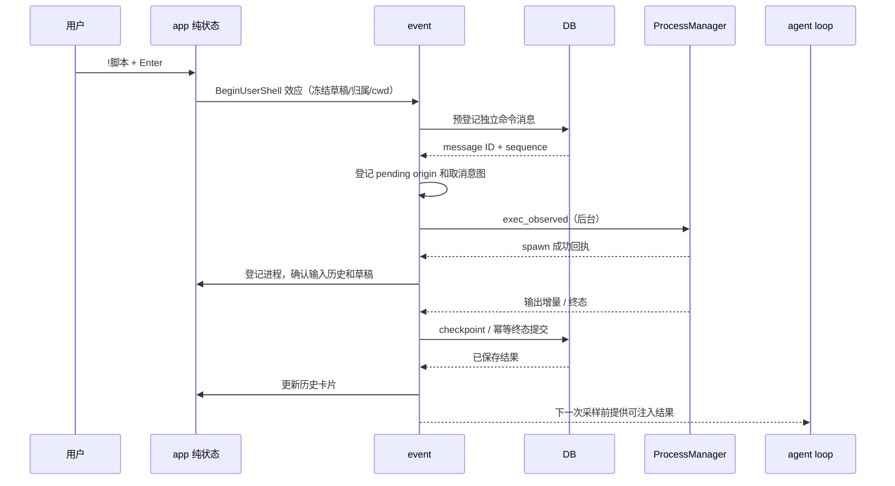

# lx 输入框 `!` 本地命令设计

状态：已实施（2026-10-22 起）。实现与验收记录见 [task.md](task.md)。

日期：2026-10-22。

参考仓库：`/Users/yonah/projects/agent/codex-main`，以当前磁盘源码为准。

## 1. 目标和审批边界

在 lx 页底部输入框实现 Codex 风格的 `!` shell 模式：用户直接执行本地命令，实时查看输出；命令结果保存到聊天会话，并作为用户提供的执行事实进入模型上下文。执行命令本身不触发模型请求。

当前阶段只允许代码检索、方案分析与本目录文档编写。用户审核本设计和 `task.md` 后，才能修改生产代码、测试、数据库迁移和项目规范。不得执行 Git 暂存、提交、切分支、建 worktree、重置等写操作。

### 1.1 已通过逐项质问确认

| 编号 | 决策 | 确认结果 |
| --- | --- | --- |
| D1 | 全角符号转换范围 | 仅输入开头的 `！` 转成 `!`；正文中的中文感叹号保留 |
| D2 | 人民币符号 | 本次不处理 `¥`，也不处理 `￥` |
| D3 | 命令结果归属 | 命令及结果保存到会话；后续模型能读取；执行时不调用模型 |
| D4 | 模型运行中执行命令 | Enter 立即执行，原模型任务继续，不被替换或重启 |
| D5 | 取消 | 保留 lx 双 Esc：第一次提示，5 秒内再次按下同时停止当前模型任务及正在运行的用户 shell 命令 |
| D6 | 取消范围 | 保留已有输出，记录中断；不停止此前独立运行、本轮未操作的后台服务 |

### 1.2 提交本次文档审核的具体默认行为

以下是依据 Codex 和现有 lx 结构提出的实现规则，不能写成用户已逐项确认：

- “开头”按 Codex 判定为**整段输入的首个非空白字符**，不是每一行的行首。`  ！pwd` 进入 shell；`你好！`、`说明\n！pwd` 保持普通文本。
- 键入、普通粘贴和历史召回采用同一模式识别；只有明确显示为 shell 模式的输入才执行。当前 lx 没有 Codex 的大段文本折叠占位机制，不新增该机制。
- shell 模式使用浅红色 `! ` 提示符和 `Shell mode` 提示，命令正文不含模式前缀。光标在正文起点按 Backspace 可退出模式并保留正文。
- 只输入 `!` 或空白命令时不启动进程、不创建会话、不记输入历史，显示使用说明。
- 本地命令不依赖模型、供应商或 API Key；三个 lx 入口均可使用本地 shell。普通聊天仍遵守 Native 入口和模型配置限制。
- 使用用户默认 shell 的登录模式执行原始脚本，默认总超时 1 小时；不把脚本按空格拆成可执行文件参数。
- cwd 对齐 lx 当前 agent 的执行环境：空闲时取所属工作区执行根；模型运行时复用该轮已冻结的 cwd。不是另外猜测全局进程目录，也不是向隐藏终端输入命令。
- 独立 shell 运行时，普通聊天提交排队到命令结束后；模型已运行时普通聊天 Enter 沿用现有不重复发送的行为。
- shell 输入忙时 Tab 排队、Enter 立即执行；空闲时 Tab 不执行。排队仅增加本功能必需的行为，不改造普通聊天的通用排队交互。
- 命令为非交互脚本执行；此次不提供 vim/top、密码输入、交互式 REPL 或独立终端 stdin 操作界面。完整交互继续使用终端页。
- 默认 shell 和平台参数复用 lx 的 `platform` 能力。Windows 沿用当前 `%COMSPEC%` 适配，不扩展 Codex 的 PowerShell 优先探测系统。

## 2. Codex 行为证据

下面路径均相对参考仓库。行号是本次检索定位，后续代码变动时应按符号复核。参考测试仅阅读，未运行。

| 关注点 | 参考源码 | 查明行为 |
| --- | --- | --- |
| 触发 | `codex-rs/tui/src/bottom_pane/chat_composer.rs:3562`，`is_bang_shell_command` | `trim_start().starts_with('!')` |
| 模式数据 | 同文件 `:3752`，`sync_bash_mode_from_text`；`:1735`，`current_text` | `!` 吸收到独立模式字段，序列化时重建 |
| 历史导入 | 同文件 `:1684`，`imported_text_for_textarea` | 导入文本也恢复 shell 模式 |
| 退出编辑模式 | 同文件 `:3711`、`:3457` | 正文起点 Backspace 退出；空命令 Esc 退出，非空命令保留 |
| 视觉 | 同文件 `:3566`、测试 `:5414` | 浅红色 `!` 和 `Shell mode` |
| 提交 | `codex-rs/tui/src/chatwidget/input_submission.rs:38`、`:231` | 去掉前缀后 trim；空命令给帮助；非空命令独立执行 |
| 输入历史 | 同文件 `:54` | 非空执行命令入历史，保留 `!` |
| 防隐藏触发 | `chat_composer.rs:3180`、`:3230` | 隐藏大粘贴展开后才出现的 `!` 按普通消息处理 |
| 模型忙时 | `codex-rs/tui/src/chatwidget/tests/exec_flow.rs:1215` | Enter 直接发出 `RunUserShellCommand` |
| Tab | `chat_composer.rs:9810`、`:10087` | 忙时排队 RunShell；闲时不执行、不清空 |
| 斜杠字面值 | 同文件 `:10116` | `!/diff` 执行 shell 命令 `/diff`，不分发内置命令 |
| 普通聊天等待 shell | `exec_flow.rs:1264` | 独立 shell 执行时聊天排队 |
| 辅助任务 | `codex-rs/core/src/session/handlers.rs:99` | 活动 turn 存在时启动 auxiliary，不替换模型任务，复用取消 token |
| shell/cwd/权限 | `codex-rs/core/src/tasks/user_shell.rs:143`、`:150`、`:211`、`:224` | 登录 shell、本地 turn cwd、显式本地执行，不走模型审批 |
| 超时与取消 | 同文件 `:47`、`:222`、`:243`、`:247` | 默认 1 小时，取消保留中断结果 |
| 上下文 | `codex-rs/core/src/user_shell_command.rs:9`；`core/src/context/user_shell_command.rs:30`、`:43` | 按输出预算格式化，作为 user 角色的 `<user_shell_command>` 记录 |
| 持久化/注入 | `core/src/tasks/user_shell.rs:440` | 独立执行保存会话；辅助执行注入当前上下文，不新开模型 turn |
| 跟进消息测试 | `core/tests/suite/user_shell_cmd.rs:406` | 跟进模型请求包含命令及结果 |
| 展示 | `codex-rs/tui/src/exec_cell/render.rs:462`、`:468`、`:576` | `Running` / `You ran`，成功失败色、无输出占位、输出中部裁剪 |

关键代码证据：

```rust
// Codex：模式识别，不把正文任意位置的 ! 误当命令。
self.config.shell_commands_enabled
    && self.current_text().trim_start().starts_with('!')

// Codex：命令使用真实 shell 语法。
let use_login_shell = true;
let display_command = environment_shell.derive_exec_args(&command, use_login_shell);
```

`！→!` 是 lx 此次新增要求。检索到的 Codex 关键路径直接识别 ASCII `!`，不能声称全角转换是照搬其已有实现。双 Esc 也是用户确认保留的 lx 交互差异。

## 3. lx 当前结构和不能跳过的问题

### 3.1 输入入口

- [键盘路由](../../../src/input/mod.rs)：`route` 将 lx 页键盘映射为 `LxInput`；终端与 prompt 输入有独立路由。
- [输入更新](../../../src/app/update/pane.rs:80)：`apply_lx_input` 处理任务页、历史、路径参照、提及、斜杠、Markdown，最后调用 `try_send` / `escape_stop`。
- [编辑状态](../../../src/app/state/lx.rs:45)：`Lx` 保存正文 `input`、字节光标、选区、面板、撤销历史；当前没有 shell 编辑模式。
- [粘贴入口](../../../src/event/paste.rs:44)：`handle_lx_paste` 优先识别文件路径，否则调用 `Lx::insert_str`。
- [输入绘制](../../../src/ui/main_content/lx/input.rs:21)：`draw` 目前固定显示 `> ` 并扫描 Markdown。

当前关键代码：

```rust
// Lx::insert_char：目前没有符号转换或模式识别。
self.snapshot();
self.input.insert(self.cursor, ch);
self.cursor += ch.len_utf8();
self.refresh_panel();
```

不能只在 Enter 时增加 `strip_prefix('!')`：那会遗漏模式提示、退格退出、历史召回、粘贴、撤销、命令正文中的 `/`/`@`/Markdown 面板冲突。

### 3.2 模型请求与取消

- [发送入口](../../../src/app/update/chat/mod.rs:46)：`try_send` 先检查入口、空草稿、busy，再检查模型并发出 `BeginChatTurn`。
- [模型状态](../../../src/app/state/lx/chat.rs:202)：`RequestState` 为 `Idle → Committing → Streaming → Finishing → Idle`，`can_send()` 仅允许 Idle。
- [Esc](../../../src/app/update/chat/mod.rs:461)：目前只有模型 busy 才能进入双 Esc 待命。
- [取消执行](../../../src/event/chat/mod.rs:31)：`stop_turn_processes` 停止该轮新建和当前操作的进程，不停止旧服务。
- [运行实例](../../../src/event/chat/runtime.rs:20)：`SessionRuntime` 按聊天会话持有 `ProcessManager`，模型轮次执行集合独立保存。

shell 不能占用或改写 `RequestState::Streaming`，也不能通过创建虚假模型轮次绕开 busy 检查。

### 3.3 进程复用

- [参数和结果契约](../../../src/chat/process/mod.rs:96)：`ExecArgs` 已有脚本、workdir、shell、login、tty、等待窗口和超时字段。
- [进程管理](../../../src/chat/process/manager/mod.rs:533)：`exec_observed` 完成 spawn 并登记后回调 `on_spawn`；等待窗口到期可能返回 Running，不代表命令结束。
- [平台能力](../../../src/platform/mod.rs:139)：`default_shell` 与 `shell_arguments` 已处理默认 shell 和平台参数。
- 管理器已有双流读取、有界输出、进程组清理、进程事件和会话上限；复用这些能力，避免写第二套 shell 执行器。

注意：`exec_observed` 的返回值、模型工具完成、操作系统进程终态是三个不同事件。用户 shell 只能在真实终态后生成最终上下文结果。

### 3.4 上下文和持久化

- 当前普通聊天提交会建立 user + assistant 两条消息；shell 需要独立 user 记录，不能伪造一个空 assistant。
- [历史装配](../../../src/chat/context/mod.rs) 当前以完整聊天轮次为单位，独立 user shell 不能直接塞进旧的成对匹配逻辑。
- 当前 `shrink_once(&Assembly)` 不能继续假定每组固定两条 turn，也不能用“遇到下一个 UserText”推断裁剪边界；现有装配类型为 `Assembly` / `PlannedTurn`。
- [agent loop](../../../src/chat/agent_loop/mod.rs) 使用自己累计的 `ModelContext`；UI/数据库中新增消息不会自动改变已运行的 loop。
- 既要支持下次普通聊天回放，也要支持当前模型下一次采样前吸收结果；这两条路径必须共用格式化规则并按稳定消息 ID 去重。

## 4. 数据结构与模块边界

本节是拟议结构，代码片段不是已存在实现。具体导出位置遵循模块公开接口，不跨深层文件导入。

### 4.1 编辑模式

```rust
#[derive(Debug, Clone, Copy, PartialEq, Eq, Default)]
pub enum LxInputMode {
    #[default]
    Chat,
    Shell,
}

// Lx.input 在 Shell 模式只保存命令正文；光标/选区始终以正文计字节。
struct LxSnapshot {
    text: String,
    cursor: usize,
    mode: LxInputMode,
}
```

- `Lx` 增加 `input_mode` 与编辑修订号；所有改写输入或模式的操作更新修订号。
- 统一 `serialized_input()`：普通模式返回正文；shell 返回 `!` + 正文。供输入历史、排队快照和发送比较使用。
- 统一完整文本导入入口：历史召回、恢复草稿通过该入口吸收首部 `!` / `！`，调整光标并关闭不适用面板。
- `snapshot`、`undo`、`redo`、`paste_cancel` 必须恢复模式和正文；修订号保持单调，不能随着 undo 倒退。
- `clear` 不能仅因正文为空而提前返回，空 shell 模式也需要可退出。
- shell 模式下 Markdown 自动续列表、`@` 提及、`/` 命令和路径参照面板全部关闭；正文按原始脚本编辑，不做路径引用格式改写。

### 4.2 命令运行与归属

```rust
// 纯数据；不包含 JoinHandle、channel 或进程句柄。
pub struct UserShellKey {
    pub pane: PaneId,
    pub session: String,
    pub message_id: String,
    pub runtime_epoch: String,
}

pub enum PendingLxSubmission {
    Shell { draft: String, cwd: PathBuf },
    Chat { draft: String },
}
```

- shell 运行记录与模型 `RequestKey` 分离；模型 generation 完成不能使仍在运行的 shell 回执失效。
- 单会话可以在既有进程上限内运行多个用户命令；每条命令有独立 message ID 和 process ID。
- 在 `app` 保存命令展示状态、待提交快照和必要的取消标记；真实任务、取消通道由 `event` 持有。
- `on_spawn` 回执之前按 message ID 记录停止意图；不能因进程 ID 尚未登记而漏掉双 Esc。
- `PendingLxSubmission` 使用 FIFO，元素冻结当时模式与正文；不得只存一个可变的“当前草稿引用”。
- 若排队发生在尚未建立会话时，队列绑定窗格的会话绑定代次；后续创建会话成功再转为 session 归属。切会话即失效，不能漂移到新会话执行。

### 4.3 状态与 IO 分层

| 层 | 职责 | 禁止事项 |
| --- | --- | --- |
| `input/` | 物理键到 `LxInput` | 不启动进程、不访问模型 |
| `app/state/lx/` | 模式、草稿、队列、命令展示 | 不持进程句柄、不读写 DB |
| `app/update/chat/` | 提交/取消纯状态机、发 Effect | 不 spawn、不 await IO |
| `event/chat/` | DB 门槛、后台执行、回执、注入调度 | 不在渲染中执行这些操作 |
| `chat/process/` | spawn、输出缓存、停止、reap | 不依赖 UI 或 app |
| `db/chat/` | 命令记录事务、状态恢复、查询 | 不执行命令 |
| `chat/context/`、`agent_loop/` | 模型项、分组裁剪、增量吸收 | 不伪造模型工具调用 |
| `ui/main_content/lx/` | 只读模式和命令记录进行绘制 | 不改状态、不读时钟/DB |

## 5. 持久化模型

### 5.1 复用消息表，区分消息来源

追加数据库迁移，不修改旧版本迁移文本。当前源码为 v11，预计新增 v12；实现开始前重新核对最新版本，若已被其他变更占用则顺延。

拟议增量：

```sql
ALTER TABLE agent_message
    ADD COLUMN kind TEXT NOT NULL DEFAULT 'chat'
    CHECK (kind IN ('chat', 'user_shell'));
ALTER TABLE agent_message ADD COLUMN user_shell_json TEXT;
```

使用一条 `role='user', kind='user_shell'` 消息表达命令。复用消息 ID、会话外键、sequence、时间和删除级联，不增加一套平行消息表，不创建虚假 `agent_tool_call` 或 assistant 消息。

- `sequence` 在命令预登记时与普通消息共享分配，决定历史展示位置。`begin_turn` 和 `begin_user_shell` 都在同一数据库事务边界内按该 session 全部消息（包含所有 kind）的 `MAX(sequence)+1` / `MAX(turn_index)+1` 分配；空会话从 0 开始。
- shell 独占一个 `turn_index` 编号，不复用当前模型轮次编号，也不按普通聊天轮数重新编号；不假造普通聊天配对，不能据此增加模型轮次/用量统计。
- 一个 text part 仅保存用户命令，供标题/摘要使用；完整执行结果只以 `user_shell_json` 为事实来源。
- `ChatMessage` / `ChatMessageView` 增加 typed kind 和可选 `UserShellRecord`，加载时按 kind 解码，不在 UI 到处解析 JSON。
- 正常 `chat` 消息默认保持原结构；旧记录不需要回填伪造 shell 数据。
- 禁止把 shell 结果塞进供应商 metadata。它是应用业务数据，不是某家模型的私有字段。

### 5.2 命令记录

```rust
// 结构示意：复用现有 ProcessState/输出快照语义，JSON 字段需稳定。
pub struct UserShellRecord {
    pub command: String,
    pub cwd: String,
    pub shell: String,
    pub state: ProcessState,
    pub exit_code: Option<i32>,
    pub duration_ms: Option<u64>,
    pub output: String,
    pub output_start: u64,
    pub output_end: u64,
    pub dropped_bytes: u64,
    pub truncated: bool,
    pub runtime_epoch: Option<String>,
    pub process_id: Option<u64>,
    pub revision: u64,
}
```

`command` 保存去模式前缀、去首尾空白后的原始脚本；正文中的 `!`、`！`、`¥`、引号、管道和换行不再变换。`shell` 保存实际使用值，后续配置变化不改写历史事实。

状态对应：

| 命令状态 | 消息 status | 是否可进入模型 |
| --- | --- | --- |
| 已登记、尚未 spawn / Running | `streaming` | 否 |
| 正常退出，包括非零退出码 | `complete` | 是，包含真实退出码 |
| spawn/运行失败 | `failed` | 是，包含实际失败原因，不伪造输出 |
| 用户停止、超时、崩溃恢复 | `interrupted` | 是，包含原因和已保存输出 |

`ProcessState` 保留 `Stopped` / `TimedOut` / `Interrupted` 的区别。UI 的用户 shell 成功判断单独使用真实退出码：非零退出显示失败色；不修改现有模型进程工具“非零退出是执行结果”的公共契约。

### 5.3 无模型的本地会话

当前 `agent_session.model_provider/model_id` 不允许 NULL，但本地命令不应要求 API Key。

拟迁移这两列为 nullable，不使用空串、假模型 ID 或隐藏的默认模型占位：

- 按现有 session 表重建迁移模式复制全部原列和主键；保留 external ID、索引、外键关系和所有消息。
- 外键切换必须按 SQLite 事务约束处理；严禁在启用级联删除时直接 DROP 被引用表导致历史丢失。
- 迁移完成运行 `foreign_key_check`；版本更新和结构变更满足原有迁移原子性约束，失败不得推进版本。
- `SessionSummary` 模型字段改为 Option；`chat_session_model()` 只在 provider 和 model 都存在时返回模型快照。
- 新增 `begin_user_shell`：可新建无模型会话并写单条命令消息，不需要 `FrozenModel`。
- 之后首次普通聊天再写入真实模型选择；`/resume` 可以恢复只有 shell 的会话，模型状态显示现有未选择状态。
- 普通 `begin_turn`、显式模型选择和历史读取仍处理真实配置，不因本地会话放宽模型请求校验。

### 5.4 事务和恢复

新增 DB 接口至少覆盖预登记、输出 checkpoint、终态完成、启动恢复；均验证 workspace、session、message 归属。

- 同一稳定 message ID 的重复完成回执幂等，不重复创建消息、输入历史或上下文。
- 输出 checkpoint 的 revision 单调；迟到的 Running 快照不能覆盖已完成/中断记录。
- 运行中输出沿用现有每秒合并写入策略，终态立即写入；文档不承诺崩溃前最后一秒尚未 checkpoint 的输出可恢复。
- 重启将遗留 `kind='user_shell'` 的在途记录标记 interrupted，保留已保存输出，不自动重跑命令。
- `agent_process.origin_call_id` 无工具外键，可用用户 shell 消息 ID 作 origin；这是内部归属标识，不向模型宣称发生了工具调用。
- 删除会话时停止进程并按现有级联规则删除命令；迟到回执不重新创建已删除会话。
- 已有删除/截断消息路径也必须覆盖用户 shell；删除历史不重跑、不撤销已经发生的文件副作用。本任务不新增 `/rewind` 命令。

## 6. 提交与执行数据流



### 6.1 Enter 分派顺序

保留全局浮层、任务页和编辑面板的既有优先级；进入 Shell 模式时关闭不适用的编辑面板，因此其 Enter 不会被 Markdown 或 `/` 候选截走。

在普通模型入口/Key/busy 校验**之前**分派 shell：

```rust
// 拟议伪代码：真实实现必须沿用 AppState/Effect 边界。
if editor.input_mode == LxInputMode::Shell {
    return try_submit_user_shell(state, pane);
}
if has_standalone_shell(state, pane) {
    return queue_chat_after_shell(state, pane);
}
try_send_chat(state, pane)
```

- 不把 shell 送进 `BeginChatTurn`，不创建 streaming assistant。
- `!/model` 交给 shell 执行 `/model`，不打开模型选择面板。
- 空命令返回帮助；缺少 cwd、DB 失败或会话归属失效时提示并保留草稿。
- 冻结草稿带 `mode + body + revision`；spawn 成功后只有修订仍匹配才清空输入。不能只比较 trim 后字符串，否则执行期间改过又改回的草稿也可能被误清空。
- spawn 成功才记一条带 `!` 的全局输入历史；命令非零退出仍属于已执行，照常入历史。排队、空命令、spawn 失败不入历史。
- spawn 成功后默认回 Chat 模式，便于继续聊天；可以通过历史召回再次编辑并执行命令。

### 6.2 参数映射与输出

复用 `ExecArgs`，设置 `login=true`、`tty=false`、`timeout_ms=Some(3_600_000)`；workdir 使用冻结 cwd，shell 使用实际默认值。

等待窗口只影响管理器第一次返回时机，不决定用户 shell 生命周期。命令运行超过现有 10 秒等待窗口仍保持 Running，持续响应输出和停止；不把它默默当成执行完成。

使用进程事件和非消费式 snapshot 更新输出，不通过空 `write_stdin` / `interact` 获取日志，避免推进模型工具的读取游标。

沿用当前会话 8 个、全局 32 个运行进程限额及缓冲限制。用户 shell 与模型进程共享这些资源，不另开无界通道绕过上限。

### 6.3 早到事件

真实进程可能在 spawn 成功回执处理前就输出或退出：

1. DB 成功后、后台 spawn 之前，先登记 message ID → pending origin。
2. `on_spawn` 将 process ID 与该 origin 关联；异步回执携带冻结的完整归属键。
3. 早到输出/退出按 origin 暂存或从管理器读取最新快照收敛，不能按“没有工具卡片”直接丢弃。
4. 在 UI 更新之前比较 revision 和终态；秒退命令直接显示终态，不回退到 Starting/Running。
5. 取消发生在 spawn 前时保存 cancel 标记；启动前再检查。若已经跨过启动临界点，获得 ID 后立即停止该进程。

## 7. 模型上下文与并发

### 7.1 稳定的命令结果文本

以 user 角色的普通文本回放，所有 transport 共用同一个格式化函数：

```text
<user_shell_command>
<command>cargo test</command>
<result>
Exit code: 101
Duration: 2.4 seconds
Output:
...受控的命令输出...
</result>
</user_shell_command>
```

- 结构由类型构造；输出中的控制序列必须先净化，文本字段按统一规则编码，不能由输出内容改变记录字段边界。
- 中断、超时、启动失败明确写状态/原因；未知退出码保留 unknown，不伪造 0。
- 输出预算复用现有 64 KiB 快照/回放上限；保留截断、丢弃字节和输出范围信息。
- 超限不能只保留一个无标识的尾巴；必须让模型和用户知道数据不完整。格式化只裁一次，重复加载不逐次缩短内容。
- 结果是用户执行事实，不注册为 assistant tool call/result，不增加模型工具步数或 token usage。

### 7.2 历史回放与裁剪

重构现有 `Assembly` / `PlannedTurn` 的分组与 `shrink_once`：显式表达普通完整聊天组和独立用户 shell 组；下面的 `ContextGroup` 是拟议新结构。

```rust
// 范围是示意；实际可用长度/索引表达，避免复制大输出。
struct ContextGroup {
    source_ids: Vec<String>,
    turn_range: std::ops::Range<usize>,
    item_range: std::ops::Range<usize>,
}
```

- 普通聊天继续只回放符合现有规则的完整轮次；shell 终态独立构成一组，无需配对 assistant。
- 历史装配与实时注入复用同一个 shell 顺序筛选规则：按提交 sequence 仅暴露连续已终态前缀，遇到未完成/未保存命令即暂缓其后命令，不能因新开请求而绕过顺序屏障。
- 保持现有工具调用与结果紧邻，shell 结果只能插在已闭合工具对之间。
- 预算与 `shrink_once` 按整组删除，不能硬编码 `drain(..2)`，也不能把第二条 `UserText` 当边界。
- `turns` 和 `items` 始终同源；纯文本 fallback transport 同样得到 shell 输出。
- 当前普通 user 草稿按明确的当前普通聊天消息 ID 或 assistant 的 turn_index 获取；排除 `kind='user_shell'`，不能反查“最后一条 user”。
- 不把运行中 partial shell 输出送给模型；终态记录才可回放。损坏 JSON 显示明确降级并记录错误，不执行其中任何内容。

### 7.3 当前模型下一次采样

在 `AgentHost` 增加读取已持久化命令结果的握手能力，由事件层回复；loop 在每次模型请求构造前吸收增量。继续使用现有唯一事件循环，不让 loop 直接读 DB。

- 活动请求保存初始扫描 sequence 水位、已见终态 ID 与当时尚未终态的命令 ID；“已扫描”和“实际纳入上下文”分开记录。初始已见但被预算裁掉的旧命令不能当成新结果重新注入；初始仍在运行的命令则允许完成后进入就绪筛选。
- 新结果按稳定 message ID 去重；即便之后从上下文裁掉，该活动请求也保留已见标记，避免旧结果反复复活。
- 只在请求发送前吸收，不修改已发出的 SSE、工具输入或当前输出。
- 工具 call/result 全部闭合之后再插入 user 结果，避免 orphan result。
- 每次增量吸收都重新计算共享分组预算，再构造请求；不能持续追加多条 64 KiB 输出导致上下文无限增长。保护当前用户输入和当前轮尚未闭合工具对，优先按整组移除最早可裁历史；若仍无法装下，走现有超预算失败路径，不偷偷截断用户脚本或拆开工具配对。
- 若模型直接完成且没有下一次采样，命令结果留在会话里，下轮正常聊天会装配；不因为命令完成额外发一次模型请求。
- 取消/模型完成时未被吸收的结果不能丢：持久记录仍是下一轮的事实来源。
- 同一会话被多个窗格打开时，各自请求去重独立，进程和持久记录仍按 session 归属；不能把 A 会话结果注入 B。

### 7.4 多命令顺序的明确取舍

历史按命令**提交 sequence**展示。实时注入也按这一顺序，只吸收连续已终态且已落库的命令前缀；遇到前面的 Running/待保存记录就暂缓后面结果。

例子：先执行 `!sleep 20`，随后执行 `!pwd`。`pwd` 的输出完成后立即显示；若前一个命令尚未结束，模型本次后续请求暂时不吸收 `pwd`，原模型继续工作。前一个命令完成后两条按提交顺序进入后续可用采样或下一轮聊天。

这是避免增加第二套持久化上下文排序日志的最小方案，**不承诺与 Codex 并发完成时的逐项注入时序一致**。单命令行为、已发模型不中断及结果可用于后续聊天保持一致。若必须“谁先完成谁立即进入模型”且重启顺序完全一致，需要另行引入持久化完成顺序，本草案不隐含加入该范围。

### 7.5 防止新增消息导致模型丢流

当前 `LxChat::streaming_message_mut()` 按 `messages.last_mut()` 找 streaming assistant，追加 shell 消息会打破该假设。

必须改为按 `RequestState::Streaming.assistant_id` 找准确目标，所有流事件、checkpoint、终态和展示更新沿用该 ID。

同样审查 `latest_user_draft`、当前轮统计、最近模型用量、选中卡片、sticky 用户消息、最近 thinking、会话标题和已有删除/截断路径：它们应明确区分普通聊天与用户 shell，不能泛化为“最后一条消息就是当前模型轮”。

## 8. 队列、停止和会话生命周期

### 8.1 排队规则

| 当前状态 | 用户动作 | 行为 |
| --- | --- | --- |
| 无模型、无 shell 在运行 | shell Enter | 立即开始 |
| 模型正在运行 | shell Enter | 立即作为辅助命令开始，模型继续 |
| 模型或 shell 正在运行 | shell Tab | 非空命令加入 FIFO，不立即执行 |
| 完全空闲 | shell Tab | 保留输入，不执行 |
| 仅独立 shell 正在运行 | 普通聊天 Enter | 冻结聊天排队，命令完成并保存后再发送 |
| 模型正在运行 | 普通聊天 Enter | 保持 lx 原有不重复发送语义 |
| 有先前排队项 | 活动任务结算完成 | 依 FIFO 逐项分派；shell 不启动模型，chat 经过正常模型校验 |

队列只保存尚未执行的纯数据，按窗格/会话绑定隔离。显示 `Queued` 及数量，让用户能区分已执行与等待执行；不把入队提示伪装成输入历史。暂不增加独立队列编辑器或持久化队列，重启不执行旧队列。

### 8.2 双 Esc

无浮层/面板接管时：

1. 有模型或用户 shell 在途时，第一次 Esc 进入现有 5 秒待命并显示停止提示。
2. 5 秒内再次 Esc，同步冻结停止目标，发出取消效应。
3. 目标为：当前模型 turn 的既有 stop_targets，**并集**当前用户 shell 的 pending/running 集合。
4. 清除该窗格/会话待执行队列，防止用户按停后立即自动执行下一条命令；清除不记执行历史。
5. 终态 shell 从停止集合删除；模型自然完成不清掉仍活着的 shell 归属。
6. 此前独立服务若既非当前用户 shell，也非本轮已操作目标，则继续运行。

已有模式退出/面板关闭优先级保留：没有活动任务时，空 Shell 模式 Esc 退出；非空 Shell 模式保留草稿。存在活动任务且没有面板时 Esc 优先走停止待命，避免空命令模式吞掉停止操作。历史浏览 Esc 仍先退出浏览。

### 8.3 生命周期

- 切焦点、切标签、切工作区不更改执行 cwd，不把回执送到当前焦点；已存在且仍绑定的会话任务继续。
- 切 lx/终端视图只影响展示，不向终端 PTY 写命令，也不重启 shell。
- `/new`、切到另一会话、删除会话、关闭最后一个持有者或退出应用时，沿现有运行实例回收路径停止相关进程，并处理 pending 取消。
- 当前同会话仍被其他窗格持有时，按既有 session 运行实例所有权判断回收，不能仅因一个窗格失焦就清理整个会话。
- 已删除或换绑窗格的迟到回执可按稳定会话记录收尾，但不得清新草稿、覆盖新会话 UI 或启动排队项。
- 真实文件和外部系统副作用不随取消或删除历史回滚。

## 9. 展示与交互细节

### 9.1 输入框

- Chat 仍用现有 `> `；Shell 用同宽 `! `，浅红色样式集中到 `ui/style.rs`，字符串集中到 `ui/text`。
- `Shell mode` 提示嵌入输入框规则行的可用位置，不额外改变输入框高度；过窄时先隐藏提示，保留 `!`。
- Shell 正文关闭 Markdown 词法高亮和列表续写；保持正文、引号、管道、`#`、`@`、`/` 的字面值。此次不引入 shell 语法解析依赖。
- 软换行、中文宽字符、选区、鼠标定位、光标、输入框滚动继续以正文坐标计算；模式前缀不进入正文复制和字节偏移。
- `Shift/Ctrl+Enter` 在 Shell 模式插入普通换行；不自动续写 `-`/`>` 等列表标记。
- Backspace 在正文起点退出 Shell；undo 可以恢复进入/退出模式及正文；普通文本中部的 `！` 永远不全局替换。

### 9.2 命令结果卡片

用户 shell 是独立历史项，使用 `Running` / `You ran` 文案，明确区别于模型执行的 `Ran` / `exec_command`。

- 标题包含状态色和用户命令；运行中实时显示受控输出；完成后保留输出、退出码和耗时。
- 无输出显示 `(no output)`；命令仍在运行但尚无输出时使用等待文案。
- 默认输出最多 6 个物理行，按宽度换行后保留首尾，中部显示明确省略行数；展开显示已保存的受控输出，最多 64 KiB。
- 这一展示是用户 shell 专用分支，不改现有模型进程卡片“输出只在后台任务页查看”的规则。
- 正文是安全文本，不解释 OSC/ANSI、不当 Markdown 执行；reuse 现有净化逻辑。
- 卡片行数、绘制、滚动、点击和复制必须共用同一布局结果；拖拽复制不触发展开，标题不承载隐藏执行按钮。
- `^o` 后台任务面板仍可查看命令完整缓存范围及停止任务；直接复用 ProcessManager 快照列表，不创建第二份任务数据。
- shell 记录不能成为 sticky 的普通用户提示词，也不能覆盖模型最近 thinking / 用量统计来源。
- 只有 shell 历史而没有普通聊天时，也要进入历史布局，不能继续显示品牌欢迎页盖住执行结果。

## 10. 失败与竞争处理

| 场景 | 必须结果 |
| --- | --- |
| cwd 不存在、shell 不可用、达到进程上限 | 提示真实失败；不调用模型；未成功 spawn 则不入输入历史、不清草稿 |
| DB 预登记失败 | 不 spawn，不发生不可追踪执行 |
| spawn 失败 | 预登记消息记失败原因，草稿保留，后续可手动修改重试 |
| spawn 成功、输出先于 ACK | 根据 origin/最新快照合并，已有输出与终态不丢失 |
| 用户在 ACK 前编辑草稿 | 旧 ACK 不清新草稿 |
| 命令产生大量 stdout/stderr | 持续 drain，缓冲和保存有界；截断有标识，事件循环不阻塞 |
| 停止与自然退出竞争 | 以管理器确认的真实终态为准，重复回执幂等，不覆盖退出码 |
| 模型结束但命令还在运行 | 命令归属继续有效，可单独双 Esc 停止 |
| 终态 DB 写入失败 | 保留内存结果，提示保存失败；只允许重试幂等写库，绝不能重跑命令或提前注入未持久结果 |
| 保存失败后仍有队列 | 暂停自动分派，保留队列并提示原因；不能假装结果已保存再发送下一条聊天 |
| 崩溃重启 | 在途命令记中断、恢复已保存输出，不自动重执行 |
| session/workspace 不匹配的回执 | 拒绝写入或更新错误会话，按日志记录归属错误 |

保存失败后的重试沿既有持久化效应机制做受控调度，稳定 message ID/revision 保证幂等；不得在热循环刷日志或持续阻塞交互。没有可保存结果时不承诺恢复未落盘内容。

## 11. 文件归属与最小拆分

下表是预计修改范围，不代表现在创建这些 Rust 文件。仅在确有实现内容时新增子模块。

| 现有位置 | 预计变化 |
| --- | --- |
| `src/app/state/lx.rs`、`src/app/state/lx/` | 编辑模式、快照、导入、历史和原始脚本编辑；建议 shell 纯规则归 `lx/shell.rs` |
| `src/app/state/lx/chat.rs` | typed shell 消息、按 assistant ID 找流目标，独立在途 shell 状态 |
| `src/app/update/pane.rs` | Enter/Tab/Esc 和面板门控；不直接写进程逻辑 |
| `src/app/update/chat/`、`src/app/effects.rs` | `user_shell.rs` 纯提交/取消状态机、效应和回执 |
| `src/event/paste.rs` | shell 粘贴绕过文件引用面板 |
| `src/event/chat/` | `user_shell.rs` 执行编排、host 增量握手、runtime 归属、回执落库 |
| `src/event/chat/timeline.rs` | 当前普通用户草稿按准确消息/轮次查找 |
| `src/db/chat/mod.rs`、`src/db/chat/` | shell 消息读写、session 模型可空、`user_shell.rs` 专属事务 |
| `src/db/migration.rs` | 追加迁移和恢复规则 |
| `src/chat/context/`、`src/chat/agent_loop/` | 独立上下文组、统一格式、下一采样注入与去重 |
| `src/app/update/chat/process.rs`、`src/event/chat/process_events.rs` | process origin 从仅工具扩展到用户 shell，不丢早到输出 |
| `src/ui/main_content/lx/input.rs`、`history/` | 模式提示、独立 shell 卡片与共享几何；建议卡片归 `history/user_shell.rs` |
| `src/ui/text*`、`src/ui/style.rs` | 英文文案、语义样式 |
| `docs/standards/` | 实现获批后同步目录结构和 TUI 行为规范 |

当前 `src/event/chat/mod.rs` 已约 965 行，不能直接再堆主体实现。`src/chat/process/manager/mod.rs` 已超过 1000 行；本方案复用其现有 API，不在那里新增一套执行路径。若实施发现必须修改此超限文件，先按实际职责拆分受影响逻辑，子文件控制约 500 行，不能用压缩排版规避上限。

## 12. 验收标准

1. 首个非空白字符 `！` 和 `!` 进入同一模式；普通正文 `！`、所有位置 `¥`/`￥` 保持原样。
2. 键入、粘贴、撤销、重做、历史召回均保持正确模式和 UTF-8 光标；Shell 不弹出 Markdown/提及/斜杠/路径参照面板。
3. `!pwd`、带管道和多行脚本在冻结 cwd 的登录 shell 执行；无模型/Key 时可用，空命令不执行。
4. 命令产生可见历史及持久结果，但不产生模型 HTTP 请求、assistant 占位或伪造工具步骤。
5. 执行后问“解释刚才的结果”，模型收到正确命令、状态和受控输出；五种 transport 和文本 fallback 同口径。
6. 模型流中提交命令，模型继续接收后续增量，不丢 thinking/text/tool 事件；后续采样按规则吸收已保存结果。
7. 并发乱序完成按提交序投递，不阻塞模型；重启后顺序和内容可解释且不重复截断。
8. 双 Esc 覆盖 pending spawn、运行中和模型已结束的命令；保留部分输出，不停止旧后台服务，不自动执行剩余队列。
9. 仅 shell 的会话可创建、恢复、删除；迁移保留所有原历史和外键；重启不重跑命令。
10. 受影响测试、格式和 Clippy 通过；真实 TUI 的视觉与交互由用户 `cargo run` 确认。

## 13. 检索与验证记录

- 已读取 `AGENTS.md` 及四份项目标准，使用 grill-me 逐项确认 D1—D6。
- 两个仓库均已存在 codegraph 和 codebase-memory 索引，无需重复初始化。
- 使用 codegraph 获取当前源码；使用 codebase-memory 的 `search_graph`、`get_code_snippet`、`trace_path`、`search_code` 和 `check_index_coverage` 定位结构、调用关系及覆盖情况。
- lx 关键引用路径覆盖检查无已记录问题，属于 best-effort 信号，不能视为证明完整。
- Codex 的 codebase-memory 索引部分陈旧，源码事实以 codegraph 当前磁盘内容和定点读取核对；没有依赖陈旧行号推断行为。
- 本阶段只新增本目录 Markdown；未修改实现、未执行数据库迁移、未启动被设计的命令、未写 Git 状态。
- 本阶段不运行 Rust 测试：没有 Rust 变更。实施后的精确测试清单见 `task.md`。

